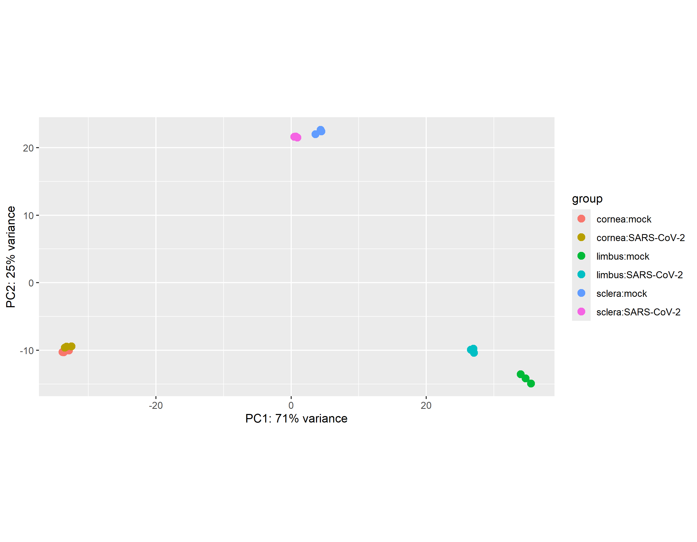
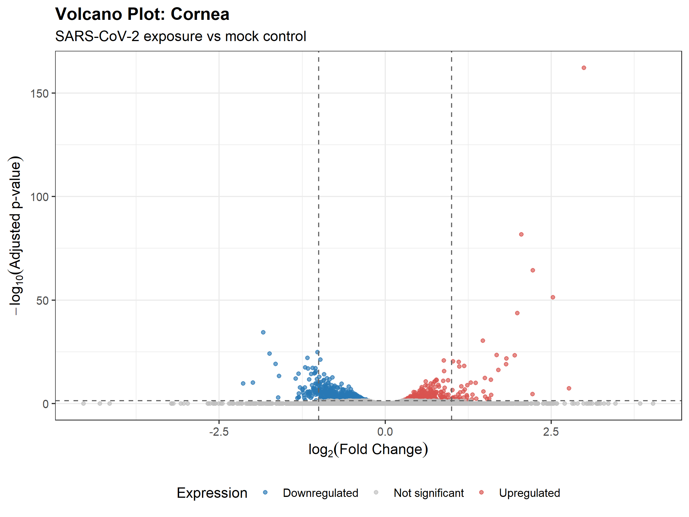
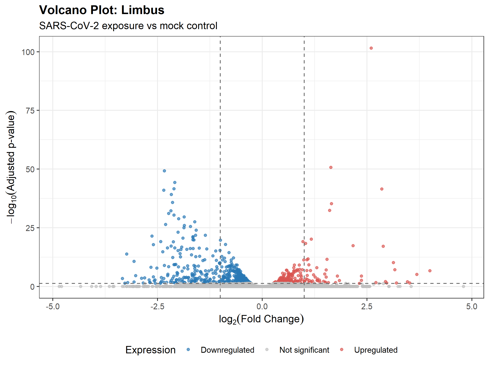
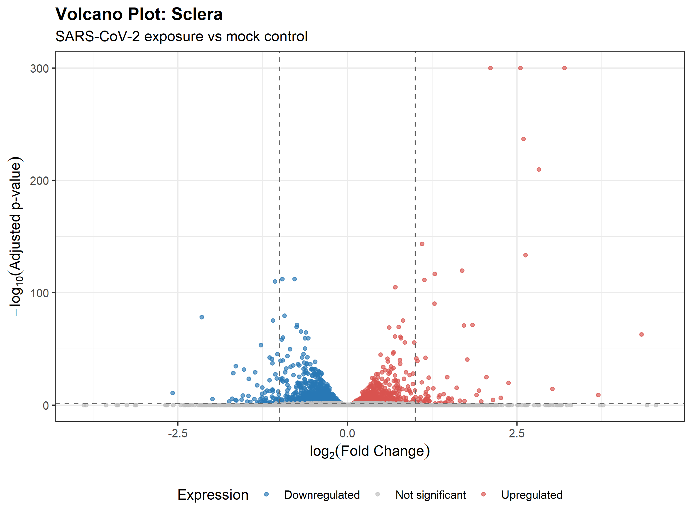
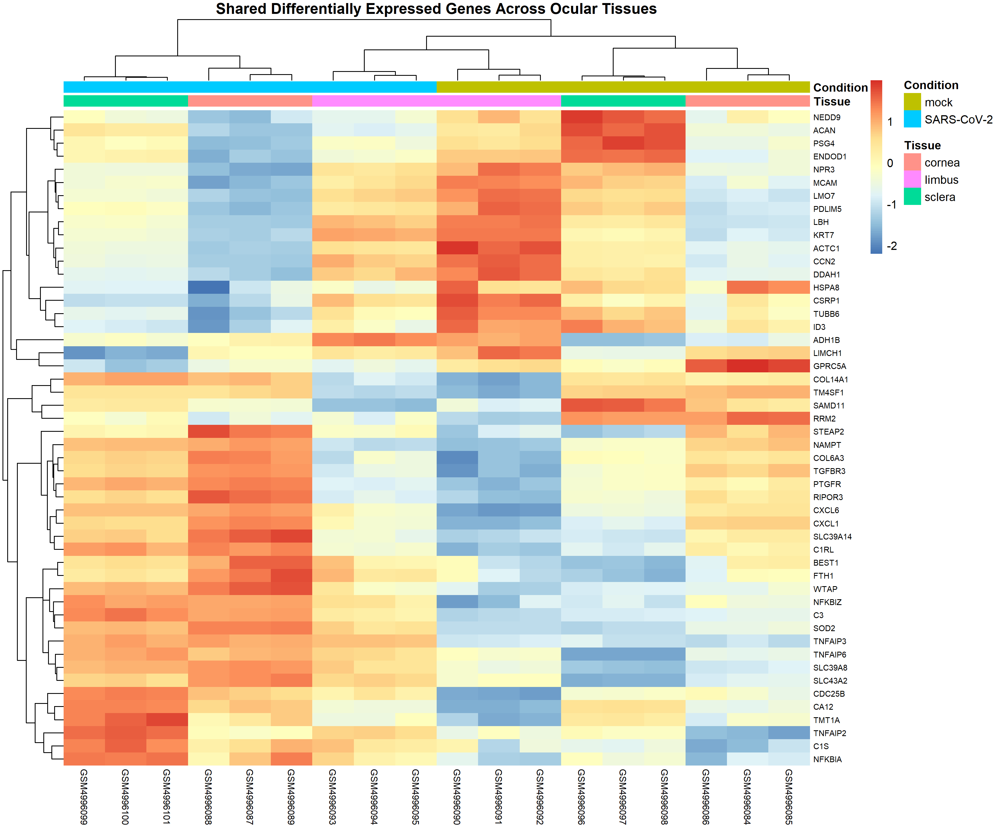

# Ocular RNA-seq response to SARS-CoV-2 exposure

This RStudio project reanalyzes bulk RNA-seq count data from human cornea, limbus, and sclera exposed to SARS-CoV-2 or mock treatment. It compares gene expression by tissue and examines shared differential-expression patterns and Gene Ontology (GO) Biological Process enrichment.

## Research question

How does SARS-CoV-2 exposure relate to gene expression in three human ocular tissues, and which differentially expressed genes are shared across the cornea, limbus, and sclera?

## Dataset and publication

The project uses [GEO series GSE164073](https://www.ncbi.nlm.nih.gov/geo/query/acc.cgi?acc=GSE164073), comprising 18 samples: cornea, limbus, and sclera, each with three biological samples per condition. The conditions are mock and SARS-CoV-2 exposure at 24 hours, as described in the source study.

The metadata used in the analysis is [`data/metadata/sample_metadata.csv`](data/metadata/sample_metadata.csv). The input is the NCBI-generated GRCh38.p13 raw count matrix at [`data/raw/GSE164073_raw_counts_GRCh38.p13_NCBI.tsv.gz`](data/raw/GSE164073_raw_counts_GRCh38.p13_NCBI.tsv.gz). This reanalysis starts from that count matrix; it does not reproduce the original paper's read alignment and quantification pipeline, which may differ from NCBI's processing.

Eriksen AZ, Møller R, Makovoz B, et al. **SARS-CoV-2 infects human adult donor eyes and hESC-derived ocular epithelium.** *Cell Stem Cell*. 2021;28(7):1205–1220.e7. [doi:10.1016/j.stem.2021.04.028](https://doi.org/10.1016/j.stem.2021.04.028).

## Analysis workflow

Run scripts from the project root in numeric order. The later steps use intermediate CSV and RDS files created by earlier scripts; these files are intentionally kept locally and excluded from GitHub.

| Step | Script | Purpose |
|---|---|---|
| 1 | [`01_initial_qc.R`](scripts/01_initial_qc.R) | Checks sample/count identifiers and summarizes library sizes and detected genes. |
| 2 | [`02_normalization_pca.R`](scripts/02_normalization_pca.R) | Estimates DESeq2 size factors, creates a variance-stabilizing transformation, and generates PCA coordinates and plot. PCA is exploratory. |
| 3 | [`03_differential_expression.R`](scripts/03_differential_expression.R) | Runs tissue-specific DESeq2 comparisons (SARS-CoV-2 vs mock) after filtering genes with total counts below 10. |
| 4 | [`04_differential_expression_qc.R`](scripts/04_differential_expression_qc.R) | Summarizes DE test results and creates tissue-specific MA plots. |
| 5 | [`05_model_diagnostics.R`](scripts/05_model_diagnostics.R) | Produces dispersion and Cook's-distance diagnostics and a summary table. |
| 6 | [`06_gene_annotation.R`](scripts/06_gene_annotation.R) | Adds gene symbols and names with `org.Hs.eg.db` and validates that gene IDs and DE statistics are preserved. |
| 7 | [`07_top_genes.R`](scripts/07_top_genes.R) | Selects genes with adjusted p-value below 0.05 and produces significant-gene subsets and a top-gene summary. |
| 8 | [`08_shared_genes.R`](scripts/08_shared_genes.R) | Summarizes gene overlap across tissues and direction consistency among genes significant in all three. |
| 9 | [`09_go_enrichment.R`](scripts/09_go_enrichment.R) | Tests GO Biological Process enrichment for shared genes consistently upregulated or downregulated across all tissues. |
| 10 | [`10_volcano_plots.R`](scripts/10_volcano_plots.R) | Creates tissue-specific volcano plots from annotated DE tables. |
| 11 | [`11_heatmap.R`](scripts/11_heatmap.R) | Creates a heatmap of up to 50 shared significant genes using the VST object. |

## Main findings

At adjusted p-value < 0.05, the existing results report 1,036 significant genes in cornea, 771 in limbus, and 3,044 in sclera. The direction summary reports 82 genes consistently upregulated in all three tissues, 50 consistently downregulated, and 54 with mixed direction. These counts come from the analysis outputs and should be interpreted cautiously given the sample size.

GO Biological Process enrichment for the direction-consistent shared gene sets includes humoral immune response, cell/leukocyte chemotaxis and migration, response to bacterium, and canonical NF-κB signaling among the upregulated set. Terms among the downregulated set include dorsal/ventral pattern formation, negative regulation of cellular response to growth factor stimulus, and BMP-related processes. These are enriched annotations associated with the input gene lists; they do not establish biological mechanisms or causality.

## Main result figures

The seven figures below highlight exploratory sample structure, tissue-specific differential expression, shared expression patterns, and GO enrichment.

**PCA**



**Tissue-specific differential expression**







**Genes shared across tissues**



**GO Biological Process enrichment**

- [Consistently upregulated shared genes](results/figures/09_GO_upregulated.pdf)
- [Consistently downregulated shared genes](results/figures/10_GO_downregulated.pdf)

## Selected quality-control figures

- Library sizes: [per-sample plot](results/figures/01_library_sizes.png)
- MA plots: [cornea](results/figures/MA_cornea.png), [limbus](results/figures/MA_limbus.png), and [sclera](results/figures/MA_sclera.png)

Dispersion and Cook's-distance plots, along with `02_raw_log_count_distributions.png`, remain local and are excluded from GitHub. The raw log-count distribution figure is excluded because its generation step is not present in scripts 01–11.

## Published result tables

The repository includes these 10 CSV result tables:

| Table | Contents |
|---|---|
| [`initial_sample_qc.csv`](results/tables/initial_sample_qc.csv) | Sample-level library sizes and detected-gene counts. |
| [`model_diagnostic_summary.csv`](results/tables/model_diagnostic_summary.csv) | Per-tissue DE test and model diagnostic summary. |
| [`DE_cornea_SARS-CoV-2_vs_mock_annotated.csv`](results/tables/DE_cornea_SARS-CoV-2_vs_mock_annotated.csv) | Full cornea DE results with gene symbols/names. |
| [`DE_limbus_SARS-CoV-2_vs_mock_annotated.csv`](results/tables/DE_limbus_SARS-CoV-2_vs_mock_annotated.csv) | Full limbus DE results with gene symbols/names. |
| [`DE_sclera_SARS-CoV-2_vs_mock_annotated.csv`](results/tables/DE_sclera_SARS-CoV-2_vs_mock_annotated.csv) | Full sclera DE results with gene symbols/names. |
| [`significant_gene_summary.csv`](results/tables/significant_gene_summary.csv) | Significant gene totals and directions by tissue. |
| [`genes_shared_all_three_tissues.csv`](results/tables/genes_shared_all_three_tissues.csv) | Full results for genes significant in all three tissues. |
| [`shared_gene_direction_summary.csv`](results/tables/shared_gene_direction_summary.csv) | Counts of shared genes by direction consistency. |
| [`GO_BP_upregulated_all_three.csv`](results/tables/GO_BP_upregulated_all_three.csv) | GO Biological Process enrichment results for shared, consistently upregulated genes. |
| [`GO_BP_downregulated_all_three.csv`](results/tables/GO_BP_downregulated_all_three.csv) | GO Biological Process enrichment results for shared, consistently downregulated genes. |

Other intermediate CSVs and the RDS objects are intentionally not included in GitHub. They remain on the analyst's computer and are regenerated by the numbered scripts when the workflow is run in order. The RDS files are ignored by `.gitignore`.

## Reproducing the analysis

1. Open `ocular_rnaseq_analysis.Rproj` in RStudio.
2. Confirm that the count matrix and sample metadata are available at the relative paths listed above.
3. Use an R/Bioconductor environment with `DESeq2`, `ggplot2`, `AnnotationDbi`, `org.Hs.eg.db`, `clusterProfiler`, `enrichplot`, and `pheatmap` installed. The project does not specify R or package versions and does not include a lockfile.

   For a fresh environment, install the CRAN packages and ensure `BiocManager` is available before installing the Bioconductor packages:

   ```r
   install.packages(c("ggplot2", "pheatmap"))

   if (!requireNamespace("BiocManager", quietly = TRUE)) {
     install.packages("BiocManager")
   }
   BiocManager::install(c(
     "DESeq2", "AnnotationDbi", "org.Hs.eg.db", "clusterProfiler", "enrichplot"
   ))
   ```

4. From the project root, run `scripts/01_initial_qc.R` through `scripts/11_heatmap.R` in numeric order. Later scripts depend on intermediate outputs from earlier scripts, including the DE tables from step 3, annotated tables from step 6, shared-gene inputs from step 8, and the VST object from step 2.

The scripts use relative paths and write outputs under `results/`. The repository does not define a command-line wrapper or workflow manager.

## Limitations

- There are three biological samples per condition per tissue. Statistical results have limited power and require cautious interpretation and independent validation.
- PCA is exploratory and is not a test of differential expression.
- This analysis uses the NCBI-generated count matrix. Differences in its upstream processing compared with the original paper's pipeline may affect results; this project does not claim exact reproduction of that pipeline.
- GO enrichment is exploratory and describes over-representation of annotations in selected gene lists, not confirmed biological mechanisms.
- Software and annotation package versions are not pinned, which limits exact computational reproducibility.

## Project structure

```text
ocular_rnaseq_analysis/
├── data/
│   ├── metadata/
│   └── raw/
├── results/
│   ├── figures/       # selected published main and QC figures
│   └── tables/        # 10 published tables; other CSVs remain local
├── scripts/           # 11 numbered R scripts
├── ocular_rnaseq_analysis.Rproj
├── .gitignore
└── README.md
```

The figure `results/figures/02_raw_log_count_distributions.png` is retained locally but excluded from GitHub because its generation step is not present in scripts 01–11.
